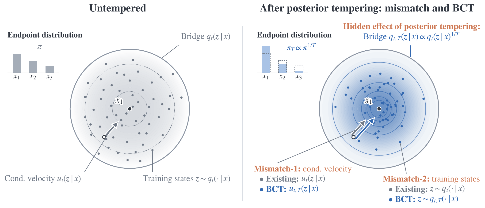
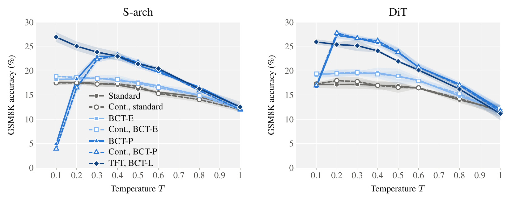

<h1 align="center">BCT: Bayes-Consistent Tempering<br>for Flow Language Models</h1>

<p align="center"><a href="https://daioba.github.io/">Daisuke Oba</a>, Hiroki Furuta, Naoaki Okazaki</p>

<p align="center">
  <a href="https://arxiv.org/abs/2610.27641"></a>
  <a href="https://huggingface.co/daisuk30ba/BCT"></a>
  <a href="https://daioba.github.io/bct/"></a>
</p>

Lowering the sampling temperature of a flow language model by tempering its
posterior over clean tokens is not consistent with the flow it integrates.
**Bayes-Consistent Tempering (BCT)** makes the tempered sampler the exact
sampler of a tempered target:

- **BCT-E** (endpoint tempering) and **BCT-P** (path tempering) are
  training-free and apply to a released model;
- **TFT** (tempered-flow training) trains the model on the tempered bridge
  with temperature conditioning, and **BCT-L** is the matching sampler, whose
  Bayes correction is scaled by a strength λ selected on held-out problems.

This repository is built on the code of
[S-FLM](https://github.com/jdeschena/s-flm) (Language Modeling with
Hyperspherical Flows) and contains the experiments on S-FLM: GSM8K with the
S-arch and DiT backbones, Sudoku-Hard, Pass@K, and standard temperature
scaling on the discrete diffusion baselines.  The experiments on the von
Mises–Fisher flow (SFCD) are not included in this release.

[Setup](#setup) · [Checkpoints](#checkpoints) · [Evaluation](#evaluation) ·
[Training](#training) · [Selecting λ](#selecting-λ) ·
[Reproducing the paper](#reproducing-the-paper) · [ABCI](#running-on-abci) ·
[Code map](#code-map) · [Citation](#citation)

<p align="center">
  
</p>

*Conceptual overview of Bayes-Consistent Tempering (BCT). Posterior tempering
implicitly changes both the endpoint distribution and the conditional bridge,
while standard sampling retains the original conditional velocities and
denoiser training states. BCT restores consistency between the bridge and
sampling dynamics, and its learned realization additionally aligns training
with the tempered bridge.*

<p align="center">
  
</p>

*GSM8K accuracy against the sampling temperature on the two backbones
(NFE = 1024). Lines are the mean over three generation seeds and bands ± one
sample standard deviation. Curves without a prefix use the released
checkpoint; Cont. (dashed) is the matched continuation. At T = 1 every BCT
correction is the identity.*

## Setup

The environment is the one of S-FLM.  We work inside the NGC PyTorch container
`nvcr.io/nvidia/pytorch:25.02-py3`:

```bash
pip install -r requirements.txt
```

`requirements.txt` does not pin `torch` or `numpy`: the container ships builds
matched to its CUDA / NCCL, and installing them with pip breaks it.  Outside
the container, install `torch` and `numpy` first (S-FLM uses `torch==2.7.0`,
`numpy==1.26.4`).

Data are handled as in S-FLM: TinyGSM is downloaded and tokenized into
`CACHE_DIR` (default `./data_cache`) on first use, the GSM8K test set is in
`data/gsm8k_test.json`, and Sudoku puzzles are generated by
`sudoku_generator.py`.

## Checkpoints

Our checkpoints are on the Hugging Face Hub at
[`daisuk30ba/BCT`](https://huggingface.co/daisuk30ba/BCT):

| File | Model in the paper |
|---|---|
| `tinygsm/sfm/sphere_arch_truncated_adaptive_no_renorm_{cont,tft}.ckpt` | S-arch Cont. / TFT |
| `tinygsm/sfm/sphere_dit_truncated_adaptive_no_renorm_{cont,tft}.ckpt` | DiT Cont. / TFT |
| `sudoku_hard/sfm/sfm_truncated_adaptive.ckpt` | Sudoku-Hard S-FLM (20k steps) |
| `sudoku_hard/sfm/sfm_truncated_adaptive_{cont,tft}.ckpt` | Sudoku-Hard Cont. / TFT |

Cont. and TFT continue a released S-FLM checkpoint for 2,000 updates, with the
original objective and with TFT respectively.  No Sudoku checkpoint of S-FLM is
released, so we trained one with its Sudoku recipe.

The released S-FLM, MDLM and Duo checkpoints are used as they are; download
them from [`jdeschena/s-flm`](https://huggingface.co/jdeschena/s-flm).  The
examples below assume this layout:

```bash
huggingface-cli download daisuk30ba/BCT --local-dir checkpoints/bct
huggingface-cli download jdeschena/s-flm \
  tinygsm/sfm/sphere_arch_truncated_adaptive_no_renorm.ckpt \
  tinygsm/sfm/sphere_dit_truncated_adaptive_no_renorm.ckpt \
  tinygsm/mdlm.ckpt tinygsm/duo.ckpt \
  --local-dir checkpoints/s-flm
```

## Evaluation

| Task | Script | GPUs |
|---|---|---|
| GSM8K (S-FLM) | [`scripts/bct/eval_gsm8k.sh`](scripts/bct/eval_gsm8k.sh) | 8 |
| Sudoku-Hard | [`scripts/bct/eval_sudoku_hard.sh`](scripts/bct/eval_sudoku_hard.sh) | 1 |
| GSM8K (MDLM / Duo) | [`scripts/bct/eval_gsm8k_dlm.sh`](scripts/bct/eval_gsm8k_dlm.sh) | 8 |

The sampler is chosen with `METHOD` and the temperature with `T`:

| `METHOD` | Sampler | Checkpoint |
|---|---|---|
| `standard` | standard tempering, `softmax(l / T)` | any |
| `bcte` | BCT-E | any |
| `bctp` | BCT-P | any |
| `bctl` | BCT-L with strength `LAMBDA` (`1.0` = full correction) | TFT (`TFT=1`) |
| `top1` | the Top-1 velocity of S-FLM (temperature-invariant) | any |

Set `TFT=1` whenever the checkpoint is a TFT checkpoint, for every method.  At
`T = 1` every BCT correction is the identity; the paper reports
`METHOD=standard T=1.0` for the `T = 1` entry of every method on GSM8K.

```bash
# Released S-FLM (S-arch), BCT-P at T = 0.4, generation seed 1
CKPT_PATH=checkpoints/s-flm/tinygsm/sfm/sphere_arch_truncated_adaptive_no_renorm.ckpt \
BACKBONE=sphere-arch METHOD=bctp T=0.4 SEED=1 \
OUTPUT_DIR=outputs/gsm8k/sarch/released/bctp_T0.4_seed1 \
bash scripts/bct/eval_gsm8k.sh

# TFT (S-arch), BCT-L with the selected lambda = 0.5 at T = 0.1
CKPT_PATH=checkpoints/bct/tinygsm/sfm/sphere_arch_truncated_adaptive_no_renorm_tft.ckpt \
BACKBONE=sphere-arch TFT=1 METHOD=bctl LAMBDA=0.5 T=0.1 SEED=1 \
OUTPUT_DIR=outputs/gsm8k/sarch/tft/bctl_T0.1_l0.5_seed1 \
bash scripts/bct/eval_gsm8k.sh

# Sudoku-Hard, TFT, BCT-L with the selected lambda = 1.0 at T = 0.1
CKPT_PATH=checkpoints/bct/sudoku_hard/sfm/sfm_truncated_adaptive_tft.ckpt \
TFT=1 METHOD=bctl LAMBDA=1.0 T=0.1 SEED=1 \
OUTPUT_DIR=outputs/sudoku_hard/tft/bctl_T0.1_l1.0_seed1 \
bash scripts/bct/eval_sudoku_hard.sh

# MDLM, standard temperature scaling at T = 0.4
MODEL=mdlm CKPT_PATH=checkpoints/s-flm/tinygsm/mdlm.ckpt T=0.4 SEED=1 \
OUTPUT_DIR=outputs/gsm8k_dlm/mdlm/T0.4_seed1 \
bash scripts/bct/eval_gsm8k_dlm.sh
```

Each run writes `OUTPUT_DIR/results.json` (accuracy, number correct, and the
generated programs).  The GSM8K settings are those of S-FLM: NFE 1024
(`STEPS`), exact velocity, greedy final decode, evaluation batch size 32; the
Sudoku settings are NFE 180 on one GPU.  The problems are split across GPUs and
the initial noise is drawn per GPU, so runs that are compared must use the same
number of GPUs (`DEVICES`, 8 in the paper for GSM8K).

## Training

**TinyGSM.** [`scripts/bct/train_tinygsm.sh`](scripts/bct/train_tinygsm.sh)
continues a released S-FLM checkpoint (step 250,000) for `ADD_STEPS=2000`
updates on 8 GPUs, resuming the optimizer, LR scheduler, EMA and adaptive noise
schedule.  `ARM=cont` keeps the S-FLM objective; `ARM=tft` trains on the
tempered bridge with temperature conditioning (per sequence, `T = 1` with
probability 0.2, `T = 0.1` with probability 0.1, and otherwise
`1/T ~ U(1.25, 5)`).

```bash
BACKBONE=sphere-arch ARM=tft \
CKPT_PATH=checkpoints/s-flm/tinygsm/sfm/sphere_arch_truncated_adaptive_no_renorm.ckpt \
OUTPUT_DIR=outputs/train/tinygsm_sarch_tft \
bash scripts/bct/train_tinygsm.sh
```

The checkpoint of the paper is `OUTPUT_DIR/checkpoints/*-252000.ckpt`.

**Sudoku-Hard.** [`scripts/bct/train_sudoku_hard.sh`](scripts/bct/train_sudoku_hard.sh)
trains on one GPU with the Sudoku recipe of S-FLM.  `ARM=base` trains the S-FLM
model from scratch for 20,000 steps (the arguments of
`scripts/train/sudoku/sfm_truncated_adaptive.sh` with `DIFFICULTY=hard`);
`ARM=cont` and `ARM=tft` continue its 20,000-step checkpoint (`CKPT_PATH`) for
2,000 updates.

The first Sudoku run generates the puzzles into `CACHE_DIR`.  With the default
single process this takes hours, so the Sudoku scripts use `SUDOKU_WORKERS`
processes (default 16); the generated puzzles do not depend on their number.

## Selecting λ

The strength λ of BCT-L is selected once per model on held-out
problems, never on the test set: the score of a λ in {0, 0.25, 0.5, 0.75, 1} is
the mean held-out accuracy over T ∈ {0.4, 0.2, 0.1} (generation seed 1), and the
largest λ wins ties.  The paper selects λ = 0.5 (S-arch), 0.25 (DiT) and 1
(Sudoku-Hard).

- **TinyGSM.** [`scripts/bct/prepare_tinygsm_heldout.py`](scripts/bct/prepare_tinygsm_heldout.py)
  builds 634 held-out problems from the TinyGSM validation split, excluding
  problems that overlap with GSM8K test or with training prompts:
  ```bash
  python scripts/bct/prepare_tinygsm_heldout.py --out-dir outputs/tinygsm_heldout --cache-dir data_cache
  ```
  `eval_gsm8k.sh` evaluates on them with `EVAL_SET=tinygsm_heldout
  HELDOUT_DIR=outputs/tinygsm_heldout`.
- **Sudoku-Hard.** The held-out set is 2,000 puzzles from the S-FLM generator
  with another seed (`EVAL_SET=heldout` in `eval_sudoku_hard.sh`).

The runs are listed by `list_runs.py lambda_gsm8k` and `lambda_sudoku`, and
`summarize.py lambda` prints the sweep and the selected λ (see below).

## Reproducing the paper

Every number in the paper is the accuracy of one evaluation run, or the mean
and standard deviation over generation seeds.  A table or figure is reproduced
in two steps:

1. **Run the evaluations.**
   [`scripts/bct/list_runs.py`](scripts/bct/list_runs.py) prints one command
   per evaluation run that a result needs, with the checkpoint, method,
   temperature, λ, seed and output directory filled in.  It does not run
   anything: run the printed lines yourself, one after another or one job per
   line on a cluster.
2. **Aggregate.** [`scripts/bct/summarize.py`](scripts/bct/summarize.py) reads
   the `results.json` files of these runs and prints the numbers of the table.
   It does not run a model.

```bash
python scripts/bct/list_runs.py gsm8k_main > runs.txt   # 312 commands
bash runs.txt                                            # or one job per line
python scripts/bct/summarize.py gsm8k --root outputs
```

| Result in the paper | `list_runs.py` | Runs | `summarize.py` |
|---|---|---|---|
| GSM8K main table and figure | `gsm8k_main` | 312 × 8 GPUs | `gsm8k` |
| Top-1 reference of the main table | `top1` | 2 × 8 GPUs | — (one `results.json` each) |
| Pass@K figure and table | `passk` | 128 × 8 GPUs | `passk` |
| Sudoku-Hard figure and table | `sudoku` | 168 × 1 GPU | `sudoku` |
| Held-out selection of λ, TinyGSM | `lambda_gsm8k` | 30 × 8 GPUs | `lambda --task gsm8k` |
| Held-out selection of λ, Sudoku-Hard | `lambda_sudoku` | 15 × 1 GPU | `lambda --task sudoku` |
| MDLM / Duo | `dlm` | 16 × 8 GPUs | `dlm` |

- One GSM8K run takes about 20 minutes on 8 H200 GPUs; one Sudoku run takes one
  or two minutes on one GPU.  `list_runs.py all` lists every run once (623
  runs; `passk` shares 48 runs with `gsm8k_main`).
- The commands assume the checkpoint layout of [Checkpoints](#checkpoints) and
  write to `outputs/`; change them with `--ckpt-dir` and `--out`.
- `lambda_gsm8k` needs the held-out problems built by
  `prepare_tinygsm_heldout.py`.  The last column of its table in the paper uses
  the DiT TFT checkpoint after 500 updates, which is not released;
  `CKPT_EVERY=500` in `train_tinygsm.sh` saves it, and `--dit-tft500-ckpt`
  lists its 15 runs.
- The S-FLM columns of the MDLM / Duo table are read from `gsm8k_main` runs
  (released checkpoints, standard tempering, seed 1).
- `summarize.py passk` regrades every generation (it executes the generated
  programs), so run it where you run the evaluation.
- With the same seed, the evaluation runs reproduce the generations of the
  paper exactly on the hardware and software we used (H200 GPUs, NGC
  `pytorch:25.02-py3`).  On other GPUs or software versions the numbers may
  differ slightly.

## Running on ABCI

[`scripts/abci_example/`](scripts/abci_example) contains example job scripts
for ABCI 3.0 (PBS Professional, H200 nodes).  Set your group and paths in
[`env.sh`](scripts/abci_example/env.sh) (the values there are placeholders),
then, for example:

```bash
# one-time setup: pull the NGC container and build a venv on top of it
qsub -P <group> scripts/abci_example/setup.sh

# one evaluation: BCT-P at T = 0.4 on the released S-arch checkpoint
qsub -P <group> -v RTYPE=rt_HF,BACKBONE=sphere-arch,MODEL=released,METHOD=bctp,T=0.4,SEED=1 \
  scripts/abci_example/eval_gsm8k.sh

# the runs of a result, one job per line of the list (mind the job limits of
# your group)
source scripts/abci_example/env.sh
python scripts/bct/list_runs.py gsm8k_main --ckpt-dir "${CKPT}" --out "${OUT}" > runs.txt
for i in $(seq "$(wc -l < runs.txt)"); do
  qsub -P <group> -v LIST="${PWD}/runs.txt",LINE="${i}" scripts/abci_example/run_list.sh
done
```

On ABCI, Singularity cannot run a `.sif` image file directly.  At the start of
each job, [`run.sh`](scripts/abci_example/run.sh) extracts the image into a
directory on the compute node's local disk (`$PBS_LOCALDIR`, about 15 seconds)
and runs the command in that container; the directory is removed when the job
ends.

## Code map

As in the S-FLM repository, S-FLM is called `sfm` in the code (`algo=sfm`,
`sampler=sfm`, `algo.SFM`, `samplers.SFMSampler`, `scripts/*/sfm_*.sh`).

| | |
|---|---|
| [`samplers.py`](samplers.py) | `sfm_log_q_unnorm`, `bct_endpoint_logits` (BCT-E); `bct_path_table` (the velocity weight `w_{a,T}` of BCT-P); `bct_trained_path_logits` (BCT-L); `SFMSampler` with `sampler.bct.mode` ∈ {`none`, `endpoint`, `path`, `trained_path`}; `bct_corruption_transport` (exact sampling of the tempered bridge) |
| [`algo.py`](algo.py) | `SFM`: TFT (`algo.bct_train_T_dist=mixture`) and resuming a released checkpoint with the new temperature-conditioning parameters |
| [`models/`](models) | temperature conditioning of S-arch and DiT (`model.temp_conditioning`) |
| [`configs/sampler/sfm.yaml`](configs/sampler/sfm.yaml), [`configs/algo/sfm.yaml`](configs/algo/sfm.yaml) | the BCT and TFT settings |
| [`tests/`](tests) | unit tests (`python -m pytest tests`; the model-level tests need a GPU) |

The rest of the code, including the baselines (AR, MDLM, Duo, FLM, CANDI) and
their training and sampling scripts in `scripts/train/` and `scripts/sample/`,
is that of S-FLM; see its
[repository](https://github.com/jdeschena/s-flm) for documentation.

## License

Apache License 2.0 ([`LICENSE`](LICENSE)).  The code is built on S-FLM, which
is distributed under the same license; see [`NOTICE`](NOTICE).  TinyGSM is
distributed under the MIT license.

## Acknowledgements

This repository is built on [S-FLM](https://github.com/jdeschena/s-flm)
(Deschenaux and Gulcehre, 2026), whose code and checkpoints we use.  S-FLM in
turn builds on [Duo](https://github.com/s-sahoo/duo),
[FLM](https://github.com/david3684/flm),
[CANDI](https://github.com/patrickpynadath1/candi-diffusion),
[PUMA](https://github.com/JaeyeonKim01/PUMA) and
[PRISM](https://github.com/JaeyeonKim01/PRISM).

## Citation

```bibtex
@article{oba2026bct,
  title={BCT: Bayes-Consistent Tempering for Flow Language Models},
  author={Oba, Daisuke and Furuta, Hiroki and Okazaki, Naoaki},
  journal={arXiv preprint arXiv:2610.27641},
  year={2026}
}
```
